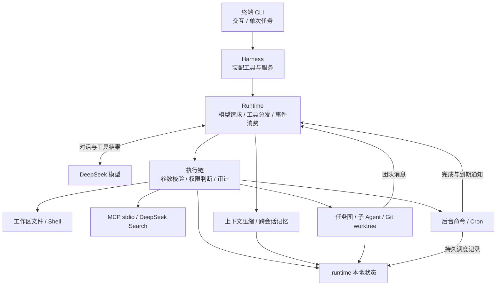
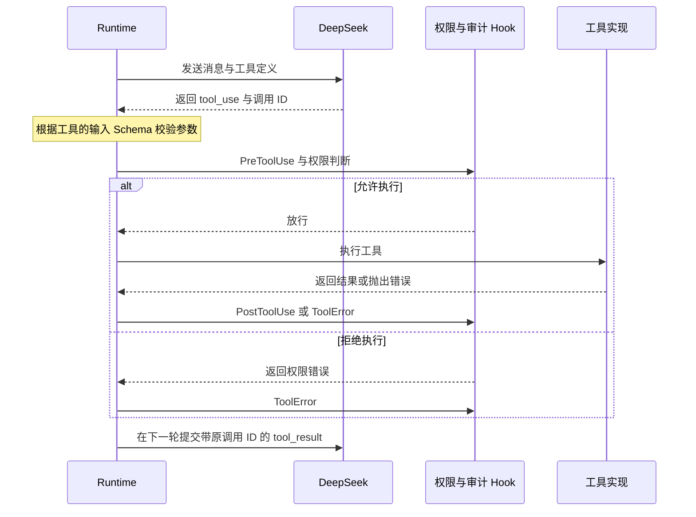

# Coder

**面向本地代码库的终端编程 Agent 与运行时。**

  

Coder 通过 DeepSeek 驱动多轮工具调用，在指定工作区内读取和编辑代码、执行命令，并将执行结果交回模型继续处理。运行时在同一条执行链上处理权限判断和审计，支持将复杂任务拆成带依赖的子任务，并可为协作任务绑定独立的 Git worktree。

[快速开始](#quickstart) · [工程架构](#architecture) · [工程规模](#metrics) · [开发与测试](#development)

## 核心能力

| 场景 | Coder 的处理方式 |
| --- | --- |
| 阅读、修改和验证代码 | 在指定工作区读写文件、精确替换文本、按模式查找路径，并使用 Bash 或 PowerShell 执行命令。终端显示工具调用和结果，权限决策与执行事件写入 JSONL 审计日志。 |
| 组织多步骤任务 | 任务图检查循环依赖，拒绝认领未就绪的任务。一次性子 Agent 使用独立消息历史，团队成员可通过邮箱协调、提交计划并认领任务。 |
| 保持长会话可用 | 大结果转存到磁盘，较早回合按回合归档。必要时生成摘要，并保留原始记录路径。技能正文按需加载，项目约束和偏好可保存为跨会话记忆。 |
| 接入外部信息和工具 | 通过 stdio JSON-RPC 发现并动态注册 MCP 工具。DeepSeek Search 同时提供终端 `/search` 命令和模型可调用的 `web_search` 工具。 |

<a id="quickstart"></a>

## 快速开始

需要 Python 3.10+。CLI 和离线测试使用 Python 标准库。Shell 命令需要对应的 Bash 或 PowerShell，worktree 功能还需要 Git 和至少有一个提交的目标仓库。

```sh
git clone https://github.com/JJJJCCCCCCC/coder.git
cd coder
python agent.py --describe
```

`--describe` 会列出当前工作区和已注册工具，无需 DeepSeek API Key。以下是实际启动输出的节选，省略了绝对路径和部分工具名。

```text
【Coder 启动】
coder
练习目录 …/coder/workspace
工具 bash, read_file, write_file, edit_file, glob, …, create_worktree, connect_mcp, web_search
```

复制配置模板，在 `.env` 中填写 `DEEPSEEK_API_KEY`，再启动交互会话。

<details open>
<summary>Windows PowerShell</summary>

```powershell
if (!(Test-Path .env)) { Copy-Item .env.example .env }
# 编辑 .env，填写 DEEPSEEK_API_KEY
python agent.py --shell powershell
```

</details>

<details>
<summary>macOS / Linux</summary>

```sh
cp -n .env.example .env
# 编辑 .env，填写 DEEPSEEK_API_KEY
python agent.py
```

</details>

默认工作区是 [`workspace/`](workspace/)，可以输入下面的问题，观察终端如何展示模型请求、文件读取、权限事件和最终回答。

> 读取 example.py，解释订单金额为 99、100、101 时分别收取多少运费，并指出判断免运费的条件。

用 `--workspace` 指向实际代码库，用 `--prompt` 单次执行。以下示例使用 Windows PowerShell。

```powershell
python agent.py --shell powershell --workspace "D:\projects\example" --prompt "阅读 README.md，概括项目的启动和测试步骤。"
```

| 交互命令 | 行为 |
| --- | --- |
| `/tools` | 列出当前已注册的工具，包括本次会话动态接入的 MCP 工具。 |
| `/search 关键词` | 直接请求 DeepSeek Search，输出标题、链接和摘要。 |
| `/clear` | 清空当前对话历史，保留磁盘上的运行状态。 |
| `/exit` | 结束会话。 |

<a id="architecture"></a>

## 工程架构

[`agent.py`](agent.py) 提供 CLI 入口，[`harness.py`](coder_harness/harness.py) 负责装配运行时。主 Agent 加载完整工具集，临时子 Agent 与团队成员从共享内核装配所需工具。



### 一次工具调用如何完成



### 代码导航

| 模块 | 核心机制 |
| --- | --- |
| [运行时](coder_harness/runtime.py) · [装配](coder_harness/harness.py) | 统一注册工具定义和处理函数，通过调用 ID 关联请求与结果，串行处理主循环中的对话和运行时通知。 |
| [权限策略](coder_harness/permission_policy.py) · [审计](coder_harness/hooks.py) · [临时文件](coder_harness/tempfiles.py) | 工具调用前判断放行、确认或拒绝，记录权限决策、执行阶段和失败信息，跟踪运行时创建的中间文件。 |
| [上下文](coder_harness/context.py) · [记忆](coder_harness/memory.py) · [技能](coder_harness/skills.py) | 转存大结果，归档并压缩较早历史。模型接口报告上下文超限时，尝试摘要压缩后重试一次。 |
| [任务图](coder_harness/tasks.py) · [子 Agent](coder_harness/subagents.py) · [团队协作](coder_harness/teams.py) | 校验依赖、在进程内串行认领并原子写入任务状态，支持团队计划审批和任务绑定的 worktree。 |
| [后台执行](coder_harness/background.py) · [定时调度](coder_harness/scheduler.py) | 后台命令和五字段 Cron 通过事件队列回到主循环。交互会话运行调度器，持久化定时任务可在下次交互启动时恢复。 |
| [MCP 客户端](coder_harness/mcp.py) · [网页搜索](coder_harness/web_search.py) · [HTTP 传输](coder_harness/http_transport.py) | 从本地配置连接 MCP 子进程并分页发现工具。DeepSeek HTTP 传输支持系统代理与应用内直连，搜索结果保留原始链接。 |

<a id="metrics"></a>

## 工程规模

以 [源码快照 `09365f4`](https://github.com/JJJJCCCCCCC/coder/tree/09365f424ad2c31abbefabcd3de1e56193963163) 为统计基准。

| 指标 | 数值 | 口径 |
| --- | ---: | --- |
| 核心 Python 文件 | **23** | `agent.py` 与 `coder_harness/` 下的 Python 文件。 |
| 核心源码行数 | **1,902** | 上述文件的物理行数，含注释和空行。样例、技能附带脚本和测试另计。 |
| 启动注册工具 | **29** | 以 `python agent.py --describe` 的工具清单为准。MCP 工具在连接后动态加入。 |
| 离线回归用例 | **18** | 来自 [`tests/`](tests/)，涵盖工具调用配对、权限、上下文、任务依赖、Cron、MCP、PowerShell、Git worktree 和搜索。 |

<a id="development"></a>

## 开发与测试

```sh
python agent.py --describe
python -m unittest discover -s tests -v
```

测试使用模型替身和搜索响应替身。MCP stdio、平台 Shell 和 Git worktree 用例会启动真实的本地进程。检查实际 DeepSeek 模型连接可运行 `python -m coder_harness.connection_check`，该命令会向服务发送请求。

### 配置与运行状态

| 配置项 | 说明 |
| --- | --- |
| `DEEPSEEK_API_KEY` | 模型请求和搜索共用的密钥。可通过仓库根目录的 [`.env.example`](.env.example) 模板或环境变量配置。 |
| `DEEPSEEK_MODEL` | 模型名称，模板值为 `deepseek-flash`。 |
| `DEEPSEEK_PROXY_MODE` | `system` 使用系统代理设置，`direct` 仅让本应用的 DeepSeek 请求绕过代理。 |
| `--workspace` / `--shell` | 指定操作目录和 Shell。默认使用 `workspace/` 与 Bash。 |
| [`mcp/mcp_servers.json`](mcp/mcp_servers.json) | 配置本地 stdio MCP 服务。仓库附带的 [示例服务](mcp/demo_server.py) 提供 `text_stats` 工具。可在会话中要求 Coder 连接 `demo`，再用 `/tools` 查看。 |

已设置的环境变量优先于 `.env`。`.runtime/` 按需保存审计日志、任务状态、定时记录、记忆和上下文归档。文件工具校验路径是否位于工作区。Shell 和本地 MCP 子进程以当前系统用户权限运行，需要文件系统级隔离时应使用受限账户或容器。

### 贡献

反馈问题时，请附上操作系统、Python 版本、Shell、最小复现命令与实际结果。提交改动时，请描述受影响的 CLI 行为及离线测试结果。请从提交中移除真实密钥、私有工作区内容和运行记录。

## 来源与许可

Coder 的集成运行时源自 shareAI Lab 的 [learn-claude-code s15](https://github.com/shareAI-lab/learn-claude-code/tree/main/s15_integrated_harness)。本仓库将相关机制拆分为 Python 模块，并围绕独立 CLI 接入 DeepSeek 模型与搜索、PowerShell 和本地 stdio MCP 示例。引入部分的 MIT 许可证和版权声明见 [`LICENSE.learn-cc`](LICENSE.learn-cc)。仓库暂无适用于新增代码的单独许可声明。
